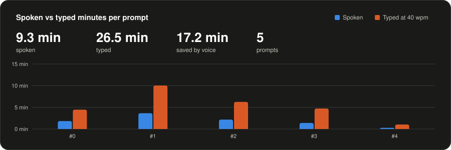
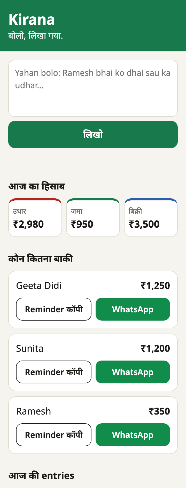

<!-- stats:start -->


| # | When | Words | Spoken | Typed | Saved |
|--:|---|--:|--:|--:|--:|
| 0 | 2026-10-10 14:21 +0530 | 179 | 1:50 | 4:28 | 2:38 |
| 1 | 2026-10-10 14:44 +0530 | 401 | 3:39 | 10:02 | 6:23 |
| 2 | 2026-10-10 15:00 +0530 | 250 | 2:10 | 6:15 | 4:05 |
| 3 | 2026-10-10 15:26 +0530 | 189 | ~1:16 | 4:44 | 3:28 |
<!-- stats:end -->

# Kirana — बोलो, लिखा गया.



A voice khata for Indian corner shops. The shopkeeper dictates the day's notes in
Hinglish. Kirana turns each note into ledger entries, asks "सही है?" on a card for
each one, keeps who owes how much, and writes the WhatsApp reminder.

- **Speak, then confirm.** "ramesh bhai ko dhai sau ka udhar" becomes "Ramesh ₹250 उधार — सही है?". Nothing is saved before confirm, and every saved card has an undo.
- **Hindi number words work.** dhai sau 250, dedh hazaar 1500, sawa hazaar 1250, saadhe teen sau 350.
- **Honorifics are trimmed.** Ramesh bhai, Ramesh ji and Shri Ramesh ji are all Ramesh.
- **कौन कितना बाकी.** Udhar minus payments per customer, with a copy-reminder button and a WhatsApp button ("Ramesh जी, ₹350 बाकी हैं।").
- **आज का हिसाब.** Three tiles for today's udhar, payments and sales, then today's entries; older ones sit under "सब entries".
- **Phone first.** 360 px wide, 44 px tap targets, Noto Sans, and a manifest and icon for Add to Home Screen.
- **Plain failure messages** for no internet, wrong key, daily cap and a confused AI. A busy AI (429) shows an "8 second रुको…" countdown and retries.

## Try it in 2 minutes

```sh
git clone https://github.com/milap1afk/Kirana && cd Kirana
python3 server.py                         # open http://localhost:8000
```

On a phone, open `http://<your-laptop-ip>:8000` on the same Wi-Fi. Press **Sample day लोड करो** to fill the empty ledger with five recorded notes;
that needs no key. To parse your own notes, get a free key from
[console.groq.com](https://console.groq.com) and put it in `.env`:

```sh
echo 'GROQ_API_KEY=your-key' > .env       # gitignored, never committed
python3 server.py demo                    # parse the 5 sample notes with the real model
```

It needs only Python 3.9 or newer; there is nothing to install.

## How this was built

Kirana was built by voice. The mouse and the Enter key were used only for approvals.

- 4 voice prompts, 12 commits, 27 tests.
- Every prompt is in [voice-log.md](voice-log.md), word for word, with its word count and timings. The chart at the top compares the minutes spoken with the minutes it would have taken to type at 40 words a minute.
- The prompts were dictated with Wispr Flow. The Wispr Flow account was made through the [Hacker House Goa referral link](https://ref.wisprflow.ai/hhg), and the Wispr Flow history matches the voice log prompt for prompt.
- The page was exercised in headless Chrome at 360 px: a real note parsed, confirm, cancel, undo, the copy-reminder and WhatsApp buttons, a faked 429 countdown, and each failure message.
- The model is `openai/gpt-oss-120b` on Groq, at temperature 0 with JSON output. The tests run on real replies recorded in [samples.json](samples.json), so they need no key.
- There are no keys in this repo: `.env` is gitignored, and the voice log redacts anything shaped like a key.

## Notes for the Wispr team

Five friction points from dictating this project into Claude Code. Every quote is
from [voice-log.md](voice-log.md); the right-hand side is what was meant.

1. **"Hinglish" always came out as "English".** "The shopkeeper says the days in English", "5 messy English notes", "a plain English line". The app's language had to be guessed from context.
2. **Hindi number words were turned into digits, and wrongly.** Paanch sau, dhai sau, dedh hazaar and sawa hazaar came out as "500 is 5 hundred. 250 is 2 hundred. 1,500 is 1,000. 1,200 is 1,25", and later as "2,00,000 or 5,00,000". These examples were the spec itself.
3. **Repo and developer words were replaced by everyday ones.** Groq → "Grok", parser → "phase", fixtures → "features", tiles → "titles", README → "Redmi", traceback → "trace book", gitignored → "get ignored".
4. **Spoken lists, numbers and addresses lost their shape.** Rules 5 and 6 became "5 keys, 11: get ignored. .env 6: don't stop to ask". 429 became "4429", "45429" and "four fake a four twenty nine". "Fourth, in" became "40 in". `wa.me` became "opens.me" and `voice-log.md` became "voice: log.md".
5. **Hindi words inside an English sentence broke.** "Ramesh bhai, Ramesh ji and Shri Ramesh ji" became "Ramesh by Ramesh by and Shri Ramesh G", and "honorifics" became "NRIфик", switching to Cyrillic mid-word. Two phrases could not be recovered at all: "and a judge face" and "judge me, just pass for just pass".

Two things that would have helped:

- **A dictionary of repo words**, built from the open project: file names, identifiers and README terms such as Groq, parser, fixtures, tiles, `voice-log.md` and `wa.me`.
- **A Hinglish mode** that keeps Hindi words and number words as spoken ("dhai sau" stays "dhai sau") instead of translating them into digits or the nearest English word.

## Layout

| File | What it does |
|---|---|
| [server.py](server.py) | The server: Groq parser, SQLite ledger, balances, today's view, manifest and icon |
| [index.html](index.html) | The page |
| [samples.json](samples.json) | Real Groq replies: the test fixtures and the sample day |
| [test_server.py](test_server.py), [test_stats.py](test_stats.py) | Tests: `python3 -m unittest` |
| [stats.py](stats.py) | Logs prompts; regenerates `chart.svg` and the table at the top |
| [.githooks/pre-commit](.githooks/pre-commit) | Runs the tests and `stats.py` on every commit (`git config core.hooksPath .githooks`) |
| [CLAUDE.md](CLAUDE.md) | The working rules |
| [voice-log.md](voice-log.md) | Every prompt |
